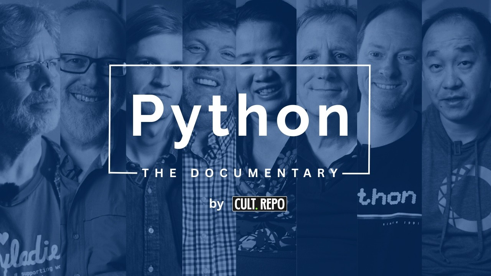
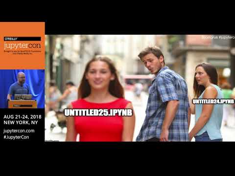

## {.center}

::: {style="text-align: center;"}
{height="560px"}

[altamarmx.github.io/ecosistema-datos]{.tiny}
:::

::: {.notes}
Mientras la gente se acomoda: escanear para seguir las diapositivas en su dispositivo.
Quien quiera hacer las prácticas: instalar uv y git ya (siguiente diapositiva).
:::

## Para seguir las prácticas 🖐

<!--
OJO: este comentario va DENTRO de la segunda diapositiva. Si se coloca antes del
primer ##, revealjs crea una diapositiva en blanco con él.

GUION DE 2 HORAS (ver TEMARIO.md)
  0–7     Bloque 0  Motivación: la reproducibilidad, medida ........ 👀
  7–12    Bloque 1  El problema y la pregunta ....................... 👀
  12–27   Bloque 2  uv y ambientes virtuales ........................ 🖐
  27–42   Bloque 3  Versionado: git y el diff ....................... 🖐
  42–57   Bloque 4  De Jupyter a marimo ............................. 🖐
  57–65   Bloque 5  Parquet ......................................... 🖐
  65–70   Pausa
  70–85   Bloque 6  src/, paquete y exploración paramétrica ......... 🖐
  85–103  Bloque 7  IA generativa: agente, harness, spec-driven ..... 👀
  103–110 Bloque 8  MCP ............................................. 👀
  110–120 Bloque 9  Cierre: por qué seguir aprendiendo a programar

Marcadores:
  caja verde punteada = PRÁCTICA (🖐, el público la hace)
  caja roja punteada  = DEMO EN VIVO (👀, solo observan)
  caja ámbar          = PISTA 🧭 hacia la tesis; el cierre las recoge todas

Fusibles si se va el tiempo: lazy/pushdown (bloque 5),
demo MCP (bloque 8, se cuenta sin demo).
-->

::: {.columns}
::: {.column width="55%" .small}
**1. Instala uv**

macOS / Linux (terminal)

```bash
curl -LsSf https://astral.sh/uv/install.sh | sh
```

Windows (PowerShell)

```powershell
irm https://astral.sh/uv/install.ps1 | iex
```

**2. Instala git** ([da clic aquí para descargarlo](https://git-scm.com/downloads)) **y dile quién eres**

```bash
git --version
git config --global user.name  "Tu Nombre"
git config --global user.email "tu@correo.mx"
```
:::
::: {.column width="45%" .small}
**Cómo leer las diapositivas**

- 🖐 **Práctica**: lo haces en tu máquina.
- 👀 **Demo**: solo observas.
- 🧭 **Pista**: una idea que vuelve al final.

No necesitas instalar Python: **uv lo instala por ti**.

::: {.pregunta}
💬 **Preséntate en el chat**<br>
nombre · institución · qué datos analizas
:::
:::
:::

::: {.notes}
Dejar esta diapositiva unos segundos extra. Lo único indispensable es uv; git suele venir
instalado en macOS/Linux. Windows: Git for Windows.
:::

<!-- ================================================================== -->
<!-- Bloque 0 · Motivación: la reproducibilidad, medida · 7 min         -->
<!-- ================================================================== -->

# ¿Por qué hablar de reproducibilidad? {.center background-color="#1f3a5f"}

[La evidencia, medida]{.modo}

## ¿Qué significa *reproducible*?

::: {.columns .vs-grandes}
::: {.column width="50%"}
::: {.vs-bien}
**Reproducibilidad**

Mismos **datos** + mismo **código** + mismas condiciones → **mismo resultado**.

*Es lo que hoy está en juego.*
:::
:::
::: {.column width="50%"}
::: {.vs-mal}
**Replicabilidad**

Misma **pregunta**, datos **nuevos** → resultados **consistentes**.

*Es otro problema (más difícil).*
:::
:::
:::

::: {.pregunta .small}
La NASEM recomienda compartir datos, métodos **y la descripción del entorno computacional**.
:::

[National Academies of Sciences, Engineering, and Medicine (2019). *Reproducibility and Replicability in Science*. doi:10.17226/25303]{.fuente}

::: {.notes}
Fijar términos antes de dar cifras: la literatura los usa de forma inconsistente.
Hoy hablamos de reproducibilidad computacional: tus datos, tu código, ¿mi máquina obtiene lo mismo?
"Describir el entorno computacional" = lo que uv.lock hará en el bloque 2.
:::

## El embudo: notebooks de artículos biomédicos

::: {.embudo}
::: {.fila}
[Notebooks ligados a artículos (PubMed Central)]{.etiqueta}
[27,271]{.barra style="width: 100%;"}
:::
::: {.fila}
[En Python]{.etiqueta}
[22,578]{.barra style="width: 82.8%;"}
:::
::: {.fila}
[Declaran sus dependencias]{.etiqueta}
[15,817]{.barra style="width: 58%;"}
:::
::: {.fila}
[Las dependencias se instalan]{.etiqueta}
[10,388]{.barra style="width: 38.1%;"}
:::
::: {.fila}
[Corren sin error]{.etiqueta}
[1,203]{.barra style="width: 4.4%;"}
:::
::: {.fila}
[Dan **el mismo resultado**]{.etiqueta}
[879 · 3.2%]{.barra .final style="width: 3.2%;"}
:::
:::

::: {.pregunta .small}
Cada escalón es una causa distinta: **dependencias**, **errores de ejecución**, **resultados que cambian**.
:::

[Samuel, S. y Mietchen, D. (2024). *GigaScience*, 13, giad113. doi:10.1093/gigascience/giad113]{.fuente}

::: {.notes}
La imagen más fuerte del bloque. Leer de arriba abajo: primero ni siquiera se puede
instalar, luego truena, y al final, aunque corra, el número no es el mismo.
Cifras de la versión publicada (2024). El preprint de 2022 (9,625 → 245) da la misma forma.
De los que sí instalan (10,388), solo ~12 % corre sin error.
:::

## No es un campo: es un patrón

::: {.cards .cuatro}
::: {.card}
[4%]{.grande}

**Notebooks Jupyter en GitHub**

[24% corre sin error; 4% reproduce el resultado. ~864 mil ejecuciones.]{.desc}

[Pimentel et al. (2019), MSR]{.desc}
:::
::: {.card}
[74%]{.grande}

**Scripts R en Harvard Dataverse**

[fallan al ejecutarse. 9,078 archivos de paquetes de replicación.]{.desc}

[Trisovic et al. (2022), *Sci. Data*]{.desc}
:::
::: {.card}
[≈26%]{.grande}

**Artículos de *Science***

[reproducibles (estimado; IC 95 % 20–32 %), aun con política de datos y código. Solo 44 % de artefactos obtenibles.]{.desc}

[Stodden et al. (2018), *PNAS*]{.desc}
:::
::: {.card}
[33%]{.grande}

**Macroeconomía**

[22 de 67 artículos reproducidos sin ayuda de los autores.]{.desc}

[Chang y Li (2015), FEDS]{.desc}
:::
:::

::: {.pregunta .small}
Distintas disciplinas, métodos y décadas: **entre ~5 % y 35 %** sin intervención humana.
:::

::: {.notes}
La fuerza está en la convergencia, no en una cifra aislada.
Honestidad: el corpus de Pimentel incluye tutoriales y tareas de GitHub, no solo investigación;
los estudios automáticos subestiman (no corrigen errores triviales).
Pimentel volverá en el bloque de marimo: es un estudio sobre notebooks de Jupyter.
:::

## Las causas tienen nombre… y herramienta

::: {.causas}
::: {.par .encabezado}
[Causa documentada]{.causa}
[]{.flecha}
[Lo que veremos hoy]{.herr}
[Bloque]{.bloque}
:::
::: {.par}
[Dependencias no declaradas: *"module not found"*]{.causa}
[→]{.flecha}
[**uv** · `uv.lock`]{.herr}
[2]{.bloque}
:::
::: {.par}
[Sin historia: ¿qué cambió y cuándo?]{.causa}
[→]{.flecha}
[**git** · el diff]{.herr}
[3]{.bloque}
:::
::: {.par}
[Estado oculto, celdas fuera de orden]{.causa}
[→]{.flecha}
[**marimo**]{.herr}
[4]{.bloque}
:::
::: {.par}
[Rutas absolutas, sin orden de ejecución]{.causa}
[→]{.flecha}
[**estructura** · `uv run`]{.herr}
[2 · 6]{.bloque}
:::
::: {.par}
[Preprocesamiento no documentado]{.causa}
[→]{.flecha}
[**narrativa** · `PLAN.md`]{.herr}
[4 · 7]{.bloque}
:::
::: {.par .tesis}
[~47 % programa **sin formación formal** en buenas prácticas]{.causa}
[→]{.flecha}
[**la pregunta de hoy**]{.herr}
[🧭]{.bloque}
:::
:::

[Causas: Samuel y Mietchen (2024); Trisovic et al. (2022); Pimentel et al. (2019). Formación: AlNoamany y Borghi (2018), *PeerJ CS*, doi:10.7717/peerj-cs.163]{.fuente}

::: {.notes}
Esta es la diapositiva puente: es el índice de la charla.
Cada fila es un bloque. La última fila no es una herramienta: es la pregunta que
dejaremos abierta en unos minutos.
:::

## Cerca de casa

::: {.columns}
::: {.column width="50%"}
::: {.card}
[2 de 65]{.grande}

**Estudios de ML para detectar fallas en HVAC**

[compartían enlace al código, y uno de esos enlaces estaba roto. Sin diferencia entre autoría académica e industrial.]{.desc}

[Mukhtar et al. (2025), arXiv:2508.00880]{.desc}
:::
:::
::: {.column width="50%"}
::: {.card}
[¿ ? %]{.grande}

**México**

[No encontramos una medición cuantitativa de reproducibilidad computacional en la producción académica mexicana.]{.desc}

[Es un vacío… y una oportunidad de investigación.]{.desc}
:::
:::
:::

::: {.notes}
Para público de energía: el problema no es "de otros campos".
México: no hay dato; replicar el diseño de Trisovic o Samuel-Mietchen con repositorios
institucionales sería un estudio original y publicable.
:::

<!-- ================================================================== -->
<!-- Bloque 1 · El problema y la pregunta · 5 min                        -->
<!-- ================================================================== -->

## Así se ve, desde dentro, un proyecto que no se reproduce

::: {.ls-grande}
```text
$ ls proyecto_tesis/
Untitled.ipynb                    analisis_final.py
Untitled1.ipynb                   analisis_final_v2.py
Untitled27.ipynb                  analisis_final_v3_AHORASI.py
Sin_titulo_copia.ipynb            script_de_chatgpt.py
datos.csv                         arreglado_con_claude_v2.py
datos_limpios.csv                 figura1.png
datos_limpios(2).csv              figura1_buena.png
datos_limpios_DEFINITIVO.csv      fig_final_USAR_ESTA.png
prueba.py                         grafica_sin_titulo (3).png
prueba2_funciona.py               resultados_viejos/
prueba3_no_tocar.py               resultados_viejos_2/
```
:::

::: {.pregunta .small}
Reproducible = otra persona (o tú en seis meses) obtiene lo mismo **con un comando**.
:::

::: {.notes}
No burlarse: todos hemos tenido esta carpeta. Con IA es peor: cada prompt genera
código nuevo más rápido de lo que ordenamos el anterior.
:::

## Y llegó la IA: el *vibe coding*

::: {.columns}
::: {.column width="58%"}

:::
::: {.column width="42%" .small}
- Andrej Karpathy, febrero de 2025: describir lo que quieres, **aceptar sin leer**, corregir por prueba y error.
- *"Siempre pico 'Accept All', ya no leo los diffs."*
- Él mismo lo acota: sirve para **proyectos desechables**.
- La ciencia no es desechable: necesita **verificación**.
:::
:::

::: {.notes}
Resumen de la charla anterior (Del vibe coding a la ciencia reproducible). No detenerse:
el punto es que la IA acelera tanto lo bueno como el desorden.
:::

# Si la IA ya escribe código, ¿para qué aprender a programar? {.center background-color="#1f3a5f"}

::: {.pregunta .small}
Volveremos a esta pregunta al final.<br>A lo largo de la presentación, el 🧭 es una **pista** para contestarla.
:::

::: {.notes}
Dejar la pregunta en el aire. No responderla. Pedir que levante la mano quien
cree que ya no hace falta. Cada bloque deja una pista ámbar; el cierre las recoge.
La primera pista viene enseguida: el documental.
:::

## {.center}

::: {.documental}
::: {.doc-texto}
[🧭]{.brujula}

[Primera pista]{.doc-etiqueta}

[Ve el documental de Python]{.doc-titulo}

[Cómo un proyecto personal de Guido van Rossum se volvió el lenguaje de la ciencia de datos. No es una historia de herramientas: es una historia de **personas que programan**.]{.doc-desc}

[▶ Verlo en YouTube](https://www.youtube.com/watch?v=GfH4QL4VqJ0){.doc-boton target="_blank"}

[*Python: The Documentary* · CultRepo, 2025 · ~90 min · gratis]{.doc-meta}
:::
::: {.doc-imagen}
[{fig-alt="Póster de Python: The Documentary"}](https://www.youtube.com/watch?v=GfH4QL4VqJ0){target="_blank"}
:::
:::

::: {.notes}
Recomendación para después de la charla, no para verla aquí.
Por qué es pista: las herramientas cambian (Python mismo empezó como proyecto
de vacaciones); lo que permanece es la comunidad y el criterio de quienes programan.
:::

## El caso de hoy: dos años de ClimaLab

::: {.columns}
::: {.column width="45%" .small}
**Estación meteorológica [ClimaLab](https://climalab.ier.unam.mx){target="_blank"} (IER-UNAM)**

- Datos **minutales**, ~2 años, ~1 millón de filas
- `tdb` [°C] · `rh` [%] · `ghi` `dni` `dhi` [W/m²]
- `ws` [m/s] · `wd` [°] · `p_atm` · `rain_acc` · `uv`
:::
::: {.column width="55%"}
| Paso | Bloque |
|---|:-:|
| Exploración en **marimo** | 4 |
| CSV → **Parquet** | 5 |
| Funciones en **`src/`** → **paquete** | 6 |
| **Barrido paramétrico** | 6 |
| Un **agente** trabaja con el plan | 7 |
| El paquete como herramienta **MCP** | 8 |
:::
:::

::: {.pregunta .small}
Un mismo caso de principio a fin: cada herramienta resuelve un problema que dejó la anterior.
:::

::: {.notes}
El hilo conductor. Los datos vienen de la charla anterior (4 meses), ahora extendidos a 2 años.
:::

<!-- ================================================================== -->
<!-- Bloque 2 · uv y ambientes virtuales · 15 min                       -->
<!-- ================================================================== -->

# uv: el entorno es un archivo {.center background-color="#1f3a5f"}

[🖐 Práctica · 15 min]{.modo}

## ¿Qué es un ambiente virtual?

::: {.pregunta .small}
Una carpeta (`.venv/`) con **su propio Python y sus propios paquetes**, aislada del resto de tu computadora.<br>**Cada proyecto tiene el suyo.**
:::

::: {.columns .vs-grandes}
::: {.column width="50%"}
::: {.vs-mal}
**🧊 Sin ambiente: el refri compartido del depa**

- *"¿Quién se acabó mi leche?"* → otro proyecto actualizó `numpy` y el tuyo truena.
- *"Ese yogurt es de 2019"* → paquetes viejos que nadie se atreve a borrar.
- *"No toques lo del casero"* → `sudo pip install` rompe el Python del sistema.
- *"En mi refri sí había"* → "en mi máquina sí funciona".
:::
:::
::: {.column width="50%"}
::: {.vs-bien}
**🍱 Con ambiente: tu lonchera con tu nombre**

- Cada proyecto, su `.venv/`: nadie más mete la mano.
- Lo que lleva está **escrito**: `uv.lock`.
- Otra persona arma **la misma lonchera**: `uv sync`.
- ¿Ya no la usas? Borras la carpeta y listo.
:::
:::
:::

::: {.small style="text-align: center;"}
Con uv no lo activas ni lo administras: `uv run` lo crea y lo usa por ti.
:::

::: {.notes}
Dejar que se rían con el refri: todos lo han vivido. Luego mapear cada chiste a un error real.
Dato para quien ya lo vio: en macOS y Linux recientes, pip fuera de un ambiente responde
"externally-managed-environment": el sistema mismo ya te pide un ambiente virtual.
:::

## "En mi máquina sí funciona"

::: {.columns}
::: {.column width="50%"}
::: {.vs-mal}
**Antes: muchas herramientas**

- `pyenv` para versiones de Python
- `venv` / `virtualenv` para entornos
- `pip` para instalar
- `pip-tools` para fijar versiones
- `pipx` para herramientas
- `requirements.txt`… **sin versiones**
:::
:::
::: {.column width="50%"}
::: {.vs-bien}
**Ahora: una sola, `uv`**

- Instala **Python** por ti
- Crea y sincroniza el **entorno**
- Agrega dependencias y las **fija** en `uv.lock`
- **Ejecuta** dentro del entorno
- Muy rápido (escrito en Rust, de Astral)
:::
:::
:::

::: {.pregunta .small}
El escalón 2 del embudo —*"no se pueden instalar las dependencias"*— es el que uv elimina.
:::

::: {.notes}
Conectar con el embudo: la mayoría de los notebooks ni siquiera se pudo instalar.
:::

## Cuatro comandos

```bash
uv init --no-package climalab  # análisis, aún no paquete: pyproject.toml, .python-version, git
cd climalab
uv add polars marimo           # instala y FIJA versiones exactas en uv.lock
uv run python analisis.py      # ejecuta dentro del entorno (lo crea si no existe)
uv sync                        # en otra máquina: reconstruye el mismo entorno
ii .                           # abre la carpeta en el explorador (Windows; en macOS: open .)
```

::: {.columns .small}
::: {.column width="50%"}
`pyproject.toml` (lo que **pides**)

```toml
[project]
name = "climalab"
requires-python = ">=3.13"
dependencies = [
    "marimo>=0.16",
    "polars>=1.30",
]
```
:::
::: {.column width="50%"}
`uv.lock` (lo que **obtuviste**)

- Versión **exacta** de cada paquete, incluidas las dependencias de tus dependencias.
- Se versiona con git.
- **La misma ciencia en otra máquina**: la tuya, la del revisor, la del agente.
:::
:::

::: {.notes}
pyproject = intención (rangos); uv.lock = hecho (versiones exactas). Ambos van a git.
No hay "activar el entorno": uv run se encarga.
:::

## Un script que trae su propio entorno

```python
# /// script
# requires-python = ">=3.13"
# dependencies = ["polars", "pyarrow"]
# ///
import polars as pl

df = pl.read_parquet("climalab.parquet")
print(df.select(pl.col("tdb").mean()))
```

```bash
uv run resumen.py      # uv lee el encabezado, crea un entorno temporal y ejecuta
```

::: {.small}
- Dependencias **en línea** (PEP 723): el script se puede mandar por correo y sigue siendo reproducible.
- Ideal para utilidades sueltas; para un proyecto, `pyproject.toml` + `uv.lock`.
:::

::: {.notes}
Este formato vuelve en la práctica de Parquet.
:::

## Estructura propuesta

```text
climalab/
├── PLAN.md                # contrato con el agente + bitácora de decisiones
├── AGENTS.md              # reglas del espacio de trabajo para el agente
├── pyproject.toml         # lo que pides
├── uv.lock                # lo que obtuviste
├── data/
│   ├── 001_raw/           # inmutable: los crudos nunca se tocan
│   ├── 002_intermediate/  # procesados (Parquet)
│   └── 003_results/       # resultados (Parquet)
├── src/climalab/          # funciones importables, cada una con prueba
├── tests/                 # pytest
└── notebooks/             # la narrativa: marimo (.py)
```

::: {.small}
Una **narrativa, no una receta**. Lo que no cambia: crudos intocables · entorno fijado · funciones con pruebas · análisis narrado.
:::

::: {.notes}
Recorrer de arriba abajo. src/ se explica a fondo en el bloque 6; aquí solo ubicarlo:
"aquí vive el código que define; en notebooks/ el que narra".
:::

## Práctica 🖐

::: {.practica}
[Práctica · 5 min]{.practica-title}

```bash
uv init --no-package climalab && cd climalab
uv add polars pyarrow marimo
uv run python -c "import polars; print(polars.__version__)"
cat pyproject.toml
ls -a                     # ¿qué más creó uv init?
```
:::

::: {.pista}
Pídele a un agente "instala polars" sin más instrucciones: lo usual es `pip install` global o un `requirements.txt` sin versiones. Repite lo que más vio al entrenarse. **Pedirle uv exige saber que existe.**
:::

::: {.notes}
Pregunta para el puente: ls -a muestra .git. uv init ya creó un repositorio git… ¿qué es eso?
:::

<!-- ================================================================== -->
<!-- Bloque 3 · Versionado: git y el diff · 15 min                      -->
<!-- ================================================================== -->

# Versionado: qué es git y por qué importa el diff {.center background-color="#1f3a5f"}

[🖐 Práctica · 15 min]{.modo}

## ¿Qué es el versionado?

::: {.columns}
::: {.column width="40%"}
{height="460px"}
:::
::: {.column .small width="60%"}
- Todos hemos versionado **a mano**: `tesis_final_por_fin_eso_espero.docx`.
- Copias con nombres… sin **autor**, sin **fecha**, sin **motivo**.
- Y la pregunta clave no tiene respuesta: **¿qué cambió** entre una y otra?
:::
:::

::: {.notes}
El meme hace el trabajo: todos reconocen esa carpeta.
:::

## git: un archivo, toda su historia

::: {.columns}
::: {.column width="55%"}
```text
$ git log --oneline
a41c9e2 Barrido: absortancia 0.2–0.8, h 5–20
7d03b1f ghi_diaria: prueba con respuesta conocida
c2e8f50 Datos 2024-10 → 2026-10 a Parquet
91fa3d4 PLAN.md firmado
0b7e2aa uv init
```
:::
::: {.column width="45%" .small}
- Un **commit** es una foto del proyecto con **autor**, **fecha** y **mensaje**.
- Cada commit es un **punto de retorno**: equivocarse deja de ser caro.
- **git** es el versionador (software libre). **GitHub** es la plataforma que lo hospeda: respaldo y colaboración, gratis para la academia ([GitHub Education](https://github.com/education)).
:::
:::

::: {.notes}
Precisión: git ≠ GitHub. Se puede usar git sin GitHub (y conviene saberlo).
:::

## Tres commits, una historia

```bash
git commit -m "Proyecto inicial con uv"
git commit -m "io.py: crudos de ClimaLab a Parquet"
git commit -m "ghi_diaria() con prueba de respuesta conocida"
```

::: {.historia}
::: {.commit}
[]{.punto}
[0b7e2aa]{.hash}
[Proyecto inicial con uv]{.msg}
[lun 10:02 · + pyproject.toml, uv.lock]{.meta}
:::
::: {.commit}
[]{.punto}
[c2e8f50]{.hash}
[io.py: crudos de ClimaLab a Parquet]{.msg}
[mar 17:40 · + src/climalab/io.py]{.meta}
:::
::: {.commit .actual}
[]{.punto}
[HEAD · estás aquí]{.head}
[7d03b1f]{.hash}
[ghi_diaria() con prueba de respuesta conocida]{.msg}
[jue 12:15 · + tests/test_radiacion.py]{.meta}
:::
::: {.commit .futuro}
[]{.punto}
[¿ … ?]{.hash}
[tu próximo cambio]{.msg}
[]{.meta}
:::
:::

::: {.pregunta .small}
Cada punto es una **foto completa** del proyecto: puedes compararlas (`git diff 0b7e2aa 7d03b1f`) o volver a cualquiera.
:::

::: {.notes}
Señalar de izquierda a derecha: cada commit guarda quién, cuándo, qué y por qué.
El mensaje es para tu yo de dentro de seis meses. HEAD = dónde estás parado.
:::

## El ciclo básico

```text
  editas archivos ──► git add ──► git commit -m "por qué" ──► git push
   (directorio)       (preparas)     (foto en la historia)     (GitHub)
        ▲                                                         │
        └──────────── git diff: ¿qué cambió desde la última foto? ┘
```

<br>

::: {.small}
- `git status`: qué está modificado.
- `git diff`: **qué cambió exactamente**, línea por línea.
- `git log`: la historia.
- `git restore archivo` / `git revert <commit>`: volver atrás.
:::

::: {.notes}
Lo mínimo indispensable. Branches y merge quedan fuera: hoy solo historia y diff.
:::

## Leer el diff: la unidad de revisión

::: {.small}
El **diff** es la lista exacta de lo que cambió: líneas que salen (`-`) y líneas que entran (`+`).
Con agentes es **el** instrumento de revisión: no relees todo, lees **el cambio**.
:::

```diff
$ git diff src/climalab/radiacion.py

 def ghi_diaria(ghi_w_m2):
     """GHI diaria en kWh/m² por día."""
-    wh = ghi_w_m2 * (1 / 60)               # cada muestra [W/m²] dura 1 min
-    return wh.resample("1D").sum() / 1000
+    return ghi_w_m2.resample("1D").mean() / 1000
```

::: {.small}
- El agente "simplificó"… y cambió `sum()` por `mean()`: ya no es **energía diaria** [kWh/m²·día], es **potencia promedio** [kW/m²].
- Corre sin error, el número parece razonable: **solo el diff lo delata**.
:::

::: {.notes}
Caso ficticio pero típico. Dos líneas rojas y una verde: leerlas toma veinte segundos.
Esta función vuelve en el bloque 6 con una prueba que también lo habría cazado.
:::

## El diff solo sirve si el archivo es texto legible

```diff
$ git diff analisis.ipynb
   {
    "cell_type": "code",
-   "execution_count": 7,
+   "execution_count": 12,
    "outputs": [
     {
      "data": {
-      "image/png": "iVBORw0KGgoAAAANSUhEUgAAA…  (40 000 caracteres)",
+      "image/png": "iVBORw0KGgoAAAANSUhEUgAAB…  (41 000 caracteres)",
 …
    "source": [
-    "diaria = ghi.resample(\"1D\").sum() / 60 / 1000"
+    "diaria = ghi.resample(\"1D\").mean() / 1000"
```

::: {.pregunta .small}
`.ipynb` es JSON con resultados incrustados: el cambio importante queda **enterrado en ruido**.
:::

::: {.notes}
Mismo error sum→mean, ahora escondido entre contadores de ejecución e imágenes en base64.
Igual que un .docx: técnicamente versionado, en la práctica ilegible. Motivo del bloque 4.
:::

## Práctica 🖐

::: {.practica}
[Práctica · 6 min · dentro de `climalab/`]{.practica-title}

```bash
git add . && git commit -m "Proyecto inicial con uv"
echo 'print("hola, ClimaLab")' > main.py
git diff                  # ¿qué cambió?
git commit -am "Saludo"
git log --oneline         # la historia
git revert HEAD           # deshacer el último commit… sin borrar la historia
```
:::

::: {.pista}
El diff solo sirve si **sabes leer código**. La IA escribe; tú revisas. Sin esa habilidad, "Accept All" es la única opción.
:::

::: {.notes}
Si alguien se atora con git config (nombre/correo), es el momento de resolverlo.
:::

<!-- ================================================================== -->
<!-- Bloque 4 · Narrativa computacional: de Jupyter a marimo · 15 min   -->
<!-- ================================================================== -->

# Narrativa computacional: de Jupyter a marimo {.center background-color="#1f3a5f"}

[🖐 Práctica · 15 min]{.modo}

## Lo que Jupyter resolvió… y lo que dejó pendiente

::: {.columns}
::: {.column width="50%"}
::: {.vs-bien}
**Resolvió**

- Código, texto y resultados **juntos**
- Exploración **interactiva**
- Una forma de **contar** el análisis
:::
:::
::: {.column width="50%"}
::: {.vs-mal}
**Dejó pendiente**

- **Estado oculto**: la memoria no coincide con lo que ves
- Celdas ejecutables **en cualquier orden**
- `.ipynb` = JSON + resultados → **diff ilegible**
- Dependencias **no declaradas**
- **No importable**: el código queda atrapado
:::
:::
:::

::: {.pregunta .small}
Recuerda: **24 %** corre, **4 %** reproduce (Pimentel et al., 2019).
:::

::: {.notes}
Jupyter fue una revolución y lo sigue siendo para enseñar. El problema no es la idea
del notebook, es el modelo de ejecución y el formato del archivo.
:::

## El estado oculto, en cuatro celdas

```python
[1]  umbral = 40                         # °C
[2]  calientes = df.filter(pl.col("tsa") > umbral)
[3]  umbral = 35                         # "probemos con 35"…
[ ]  fig = graficar(calientes)           # ¿con 35 o con 40?
```

::: {.small}
- La celda `[2]` **no se volvió a ejecutar**: `calientes` sigue calculado con 40.
- Si borras la celda `[1]`, `umbral` **sigue en memoria**.
- El archivo guardado dice 35; la figura se hizo con 40. **Nadie lo nota.**
:::

::: {.video}
[{fig-alt="Joel Grus en JupyterCon 2018: meme del novio distraído con Untitled25.ipynb"}](https://www.youtube.com/watch?v=7jiPeIFXb6U){target="_blank"}

::: {.video-texto}
[🎥 Para ver después]{.video-etiqueta}

[*"I don't like notebooks"*]{.video-titulo}

[Joel Grus, en **JupyterCon 2018**, la conferencia de Jupyter: los problemas del estado oculto, contados con memes.]{.video-desc}

[▶ Verlo en YouTube](https://www.youtube.com/watch?v=7jiPeIFXb6U){.doc-boton target="_blank"}
:::
:::

::: {.notes}
Pimentel documentó exactamente esto: celdas fuera de orden y estado oculto.
Preguntar: ¿a quién le ha pasado? Casi todas las manos.
Grus dio esta charla EN la conferencia de Jupyter (2018): la crítica viene de dentro
de la comunidad. Abrió "la primera gran guerra de los notebooks". ~40 min, en inglés.
:::

## marimo: el notebook como grafo reactivo

::: {.columns}
::: {.column width="55%"}
```python
import marimo

app = marimo.App()

@app.cell
def _():
    import marimo as mo
    import polars as pl
    return mo, pl

@app.cell
def _(mo):
    umbral = mo.ui.slider(30, 50, value=40,
                          label="Umbral [°C]")
    umbral
    return (umbral,)

@app.cell
def _(df, pl, umbral):
    calientes = df.filter(pl.col("tsa") > umbral.value)
    return (calientes,)
```
:::
::: {.column width="45%" .small}
- Cada celda declara lo que **usa** y lo que **define**.
- Cambias `umbral` → se re-ejecuta **todo lo que depende** de él.
- Borras una celda → sus variables **desaparecen**.
- Una variable se define en **una sola celda**.
- El archivo es **Python puro**: diff limpio en git.
:::
:::

::: {.notes}
No hace falta escribir ese formato a mano: el editor lo genera. Lo que importa es que
el archivo es texto, ordenado por dependencias, y legible en un diff.
:::

## Un archivo, cuatro usos

| | Comando |
|---|---|
| Editar (notebook reactivo) | `uv run marimo edit exploracion.py` |
| Ejecutar como **script** | `uv run python exploracion.py` |
| Servir como **app** (oculta el código) | `uv run marimo run exploracion.py` |
| Exportar a HTML que corre **en el navegador** | `uv run marimo export html-wasm exploracion.py -o sitio/` |

<br>

::: {.small}
- Las funciones de un notebook marimo se pueden **importar** desde otro código.
- La app con sliders reemplaza muchos casos en los que antes hacía falta un framework web.
:::

::: {.notes}
"Como app" = el mismo archivo, sin tocar código. Para compartir con alguien que no programa.
:::

## IA en el editor, Quarto para publicar

::: {.columns}
::: {.column width="50%" .small}
**IA dentro de marimo**

- Generar y corregir celdas conociendo **tus variables y tus datos**.
- Proveedor en la **nube** o un modelo **local** (Ollama).
- Sigue siendo reactivo y en `.py`: lo que la IA escribe **se ve en el diff**.
:::
::: {.column width="50%" .small}
**Quarto sigue siendo la capa de publicación**

- Artículo, reporte, tesis, **estas diapositivas**.
- `quarto render` regenera figuras y tablas desde el código.
- marimo para **explorar e interactuar**; Quarto para **publicar**.
:::
:::

::: {.notes}
No es marimo contra Quarto: es explorar contra publicar. Estas diapositivas son un .qmd.
:::

## Práctica 🖐

::: {.practica}
[Práctica · 6 min]{.practica-title}

```bash
uvx marimo tutorial intro         # recorrido oficial, interactivo
uv run marimo edit exploracion.py # tu primer notebook, dentro de climalab/
git diff                          # tras mover un slider y guardar: ¿qué cambió?
```
:::

::: {.demo}
[Demo en vivo · 2 min]{.demo-title}
El mismo cambio (`sum` → `mean`) hecho en un `.ipynb` y en un notebook marimo: comparamos los dos `git diff`.
:::

::: {.pista}
Una herramienta nueva **elimina clases enteras de errores** (estado oculto, orden de ejecución). Estar al día no es moda: es dejar de cometer errores que ya tienen solución.
:::

<!-- ================================================================== -->
<!-- Bloque 5 · Parquet · 8 min                                          -->
<!-- ================================================================== -->

# Parquet: datos que se leen como datos {.center background-color="#1f3a5f"}

[🖐 Práctica · 8 min]{.modo}

## CSV vs. Parquet

::: {.columns}
::: {.column width="50%"}
::: {.vs-mal}
**CSV**

- Texto: **sin tipos** (la fecha llega como texto)
- Se guarda **por filas**: para una columna, lees todas
- Sin compresión: **pesado**
- Ambiguo: separadores, decimales, codificación
:::
:::
::: {.column width="50%"}
::: {.vs-bien}
**Parquet**

- Binario **tipado**: `datetime` sigue siendo `datetime`
- Se guarda **por columnas**: lees solo las que pides
- **Comprimido** por columna
- Metadatos: esquema y estadísticas por bloque
:::
:::
:::

::: {.small}
Regla del proyecto: **crudos inmutables** tal como llegan; todo lo derivado, en Parquet.
Parquet es binario: no se versiona con git, **se regenera** con el código.
:::

## Dos años de ClimaLab

| ~1 millón de filas · 11 variables | CSV | Parquet |
|---|---:|---:|
| Tamaño | ~85 MB | ~21 MB |
| Lectura con pandas | ~1.4 s | ~0.07 s |
| Lectura con Polars | ~0.25 s | ~0.05 s |
| Tipo de `date` al leer | `str` (hay que convertir) | `datetime` |
| Media de `tdb` (lazy, una columna) | lee todo el archivo | ~0.01 s |

[Estimado a partir de 4 meses medidos (172 433 filas: CSV 14.1 MB, Parquet 3.4 MB).]{.fuente}

::: {.notes}
TODO al tener los 2 años: reemplazar por la medición real (correr el script de la práctica).
El dato que más sorprende no es la velocidad: es que el CSV pierde el tipo de la fecha.
:::

## Lazy: leer solo lo que necesitas

```python
import polars as pl

resultado = (
    pl.scan_parquet("data/002_intermediate/climalab.parquet")  # no lee nada todavía
      .filter(pl.col("date").dt.year() == 2025)                # filtra al leer
      .select("date", "tdb")                                   # solo 2 de 11 columnas
      .group_by_dynamic("date", every="1mo")
      .agg(pl.col("tdb").mean())
      .collect()                                               # ahora sí ejecuta
)
```

::: {.small}
- Polars arma un **plan** y lo optimiza: solo lee las columnas y los bloques que necesita.
- DuckDB hace lo mismo con SQL: `SELECT avg(tdb) FROM 'climalab.parquet'`.
:::

::: {.notes}
Fusible: si vamos tarde, saltar esta diapositiva.
:::

## Práctica 🖐

::: {.practica}
[Práctica · 4 min · `uv run csv_vs_parquet.py`]{.practica-title}

```python
# /// script
# dependencies = ["polars", "pandas", "pyarrow"]
# ///
import os, time
import pandas as pd, polars as pl

pl.read_parquet("climalab.parquet").write_csv("climalab.csv")
for f in ["climalab.csv", "climalab.parquet"]:
    print(f, os.path.getsize(f) // 1_000_000, "MB")

t = time.perf_counter(); csv = pd.read_csv("climalab.csv");      print("CSV", time.perf_counter() - t)
t = time.perf_counter(); pq = pd.read_parquet("climalab.parquet"); print("Parquet", time.perf_counter() - t)
print(csv.dtypes["date"], "vs", pq.dtypes["date"])
```
:::

::: {.pista}
Si no dices otra cosa, el agente guarda en CSV. **Elegir el formato es una decisión técnica** que nadie toma por ti.
:::

::: {.notes}
El CSV se genera localmente a partir del Parquet: nadie descarga 85 MB por la red del evento.
:::

# Pausa · 5 min {.center background-color="#1f3a5f"}

<!-- ================================================================== -->
<!-- Bloque 6 · src/, paquete y exploración paramétrica · 15 min         -->
<!-- ================================================================== -->

# De `src/` al paquete instalable {.center background-color="#1f3a5f"}

[🖐 Práctica · 15 min]{.modo}

## El notebook narra; `src/` define

::: {.columns}
::: {.column width="50%"}
```text
src/climalab/
├── __init__.py
├── io.py         # crudos → Parquet limpio y tipado
├── radiacion.py  # ghi_diaria(), …
└── modelo.py     # la función del barrido
tests/
└── test_radiacion.py
notebooks/
└── exploracion.py   # importa de climalab
```
:::
::: {.column width="50%" .small}
- En `src/` vive el código que **define**: funciones con docstring, **unidades** y prueba.
- El notebook **narra**: carga, llama, grafica, interpreta.
- La misma función se importa desde marimo, pytest, un script… **o el agente**.
- Layout `src/`: obliga a **instalar** el paquete, así que lo que pruebas es lo que se instala.
:::
:::

::: {.pregunta .small}
¿Cuándo sacar código del notebook? Cuando lo **copiaste dos veces** o cuando **necesita una prueba**.
:::

## Una función, una prueba con respuesta conocida

::: {.columns}
::: {.column width="50%"}
```python
# src/climalab/radiacion.py
def ghi_diaria(ghi_w_m2):
    """Energía solar diaria sobre
    superficie horizontal.

    ghi_w_m2: serie minutal [W/m²]
    regresa:  [kWh/m²·día]
    """
    wh = ghi_w_m2 * (1 / 60)  # 1 min
    return wh.resample("1D").sum() / 1000
```
:::
::: {.column width="50%"}
```python
# tests/test_radiacion.py
import pandas as pd
from pytest import approx
from climalab.radiacion import ghi_diaria

def test_ghi_constante_un_dia():
    idx = pd.date_range("2026-01-01",
                        periods=1440, freq="1min")
    ghi = pd.Series(1000.0, index=idx)
    # 1000 W/m² durante 24 h = 24 kWh/m²
    assert ghi_diaria(ghi).iloc[0] == approx(24.0)
```
:::
:::

::: {.small}
Con el cambio `sum()` → `mean()` del bloque 3, esta prueba da **1.0** en vez de 24.0 y **falla**. Diff y prueba: redundancia deliberada.
:::

::: {.notes}
La respuesta la escribe la persona, no el agente: si el agente escribe código y prueba,
la prueba puede ser tautológica.
:::

## Del `src/` al paquete instalable

```bash
uv build                                              # genera dist/*.whl
uv add git+https://github.com/usuario/climalab        # instalar desde GitHub
uv add enerhabitat                                    # o desde PyPI
```

::: {.columns .small}
::: {.column width="50%"}
- Documentado, **versionado**, **citable** (Zenodo da DOI a cada versión).
- Quien lo usa lo fija en **su** `uv.lock`: tu ciencia se vuelve **dependencia reproducible** de la de otros.
:::
::: {.column width="50%"}
::: {.pregunta}
Caso en casa: [**EnerHabitat** en PyPI](https://pypi.org/project/enerhabitat/)

`uv add enerhabitat`
:::
:::
:::

::: {.notes}
EnerHabitat: transferencia de calor en envolventes, IER-UNAM.
El mensaje no es "publiquen paquetes": la estructura src/ + tests/ deja el paquete casi listo.
:::

## Exploración paramétrica

::: {.columns}
::: {.column width="44%"}
```python
# src/climalab/modelo.py
def temperatura_sol_aire(tdb, ghi, a=0.6,
                         h=13.0, eps_dr=63.0):
    """Temperatura sol-aire, superficie
    horizontal [°C].

    tdb    temperatura del aire [°C]
    ghi    irradiancia global [W/m²]
    a      absortancia solar [-]
    h      coef. convectivo [W/m²K]
    eps_dr ε·ΔR, intercambio de onda
           larga con el cielo [W/m²]
    """
    return tdb + (a * ghi - eps_dr) / h
```
:::
::: {.column width="56%"}
```python
# barrido.py
import itertools
import polars as pl
from climalab.modelo import temperatura_sol_aire

df = pl.read_parquet(
    "data/002_intermediate/climalab.parquet")
filas = []
for a, h in itertools.product([0.2, 0.4, 0.6, 0.8],
                              [5, 10, 15, 20]):
    tsa = temperatura_sol_aire(df["tdb"], df["ghi"],
                               a=a, h=h)
    filas.append({"absortancia": a, "h": h,
                  "tsa_max": tsa.max(),
                  "horas_sobre_40": (tsa > 40).sum() / 60})
pl.DataFrame(filas).write_parquet(
    "data/003_results/barrido.parquet")
```
:::
:::

::: {.small}
Una función bien definida + una malla de parámetros = **barrido**. Resultado → Parquet → **slider en marimo**.
:::

::: {.notes}
16 combinaciones × 1 millón de minutos. La función es pura: sin archivos, sin estado; por eso
se puede barrer, probar y, en el bloque 8, exponer como herramienta para un agente.
:::

## Práctica 🖐

::: {.practica}
[Práctica · 5 min]{.practica-title}

```bash
uv add "git+https://github.com/AltamarMx/ecosistema-datos#subdirectory=climalab"
uv run python barrido.py
uv run marimo edit notebooks/barrido.py   # slider de absortancia → horas sobre 40 °C
```
:::

::: {.pista}
Decidir **qué es una función**, qué parámetros barrer y **qué prueba la valida** es diseño, no tecleo. Ahí está el valor de saber programar.
:::

::: {.notes}
TODO: confirmar URL del paquete del taller cuando el repo esté publicado.
:::

<!-- ================================================================== -->
<!-- Bloque 7 · IA generativa · 18 min                                   -->
<!-- ================================================================== -->

# IA generativa: del chat al agente {.center background-color="#1f3a5f"}

[👀 Demo · 18 min]{.modo}

## El modelo, solo

::: {.columns}
::: {.column width="50%"}
```text
  tú ──── texto ────►  ┌────────┐
                       │ modelo │
  tú ◄─── texto ─────  └────────┘
```
:::
::: {.column width="50%" .small}
- Texto entra, texto sale.
- **No ve** tus archivos, **no ejecuta** nada, **no sabe** si su código corre.
- Tú copias, pegas, ejecutas y le cuentas el error.
- Tú eres el bucle.
:::
:::

::: {.notes}
Así usa la IA la mayoría: chat en el navegador. Útil, pero el humano hace todo el trabajo de ida y vuelta.
:::

## + herramientas + bucle = agente

::: {.columns}
::: {.column width="50%"}
```text
           ┌───────────┐
           │  PLAN.md  │
           └─────┬─────┘
                 ▼
   ┌──► propone una acción
   │             │
   │             ▼
 corrige   ejecuta herramienta
   ▲      (leer, escribir, correr,
   │       pytest, uv run …)
   │             │
   └─── observa el resultado
```
:::
::: {.column width="50%" .small}
- **Herramientas**: leer y escribir archivos, ejecutar comandos, correr pruebas.
- **Bucle**: propone → ejecuta → observa → corrige → repite, hasta cumplir la tarea.
- A diferencia del chat, **actúa sobre tu repositorio** y ve sus propios errores.
- Multiplica la velocidad… **y el daño** si no hay reglas.
:::
:::

## El *harness*: lo que convierte un modelo en agente

::: {.columns}
::: {.column width="50%"}
::: {.capas}
::: {.capa .harness}
[Harness]{.nombre}
permisos · contexto · memoria

::: {.capa .herramientas}
[Herramientas]{.nombre}
archivos · terminal · pruebas · MCP

::: {.capa .modelo}
Modelo
:::
:::
:::
:::
:::
::: {.column width="50%" .small}
El *harness* (arnés) es el programa que envuelve al modelo. Decide:

- **Qué herramientas** tiene y con qué **permisos**: ¿puede borrar? ¿pide confirmación?
- **Qué contexto** carga: `AGENTS.md`, el plan, el repositorio.
- Cómo maneja la **memoria** y las conversaciones largas.

Ejemplos: **Claude Code**, **Codex CLI**, **OpenCode**; también el asistente de **marimo**.
:::
:::

::: {.notes}
Idea central del bloque: lo que llamamos "la IA" son dos cosas separables, el modelo y el harness.
Dos agentes con el mismo modelo se comportan muy distinto según su harness y su contexto.
:::

## Modelo ≠ harness: nube y local

::: {.columns .vs-grandes}
::: {.column width="50%"}
::: {.vs-bien}
**Nube** (p. ej. Claude, GPT, Gemini)

- Modelos de frontera, los más capaces
- Sin hardware propio; costo por uso
- Los datos **salen de tu máquina**
:::
:::
::: {.column width="50%"}
::: {.vs-mal}
**Local** (p. ej. Qwen vía MLX u Ollama)

- Los datos **no salen**; sin costo por token
- Exige **hardware capaz** (memoria unificada o GPU)
- Rinde menos que la frontera
:::
:::
:::

::: {.pregunta .small}
El mismo harness puede usar uno u otro motor: la decisión es **por proyecto**, no ideológica.
:::

::: {.notes}
Nube para trabajo pesado; local cuando los datos no deben salir o para tareas acotadas.
:::

## `AGENTS.md`: las reglas del espacio de trabajo

::: {.columns}
::: {.column width="55%"}
```markdown
# AGENTS.md

## Entorno
- Dependencias solo con `uv add`; nunca `pip install`.
- Todo se ejecuta con `uv run`.

## Datos
- `data/001_raw/` es de solo lectura.
- Derivados en Parquet, nunca CSV.

## Código
- Funciones en `src/climalab/`, con docstring,
  unidades y prueba.
- Notebooks en marimo (`.py`), no `.ipynb`.

## Flujo
- Una sección de PLAN.md a la vez.
- Detente y muestra el diff antes del commit.
```
:::
::: {.column width="45%" .small}
- El harness lo carga **en cada sesión**.
- Cada regla es una decisión de esta charla: uv, Parquet, `src/`, marimo, diff.
- Sin este archivo, el agente usa **sus defaults**: los de sus datos de entrenamiento.
:::
:::

::: {.notes}
Notar que cada línea de AGENTS.md corresponde a un bloque de hoy. Escribirlo exige
saber todo lo anterior: ese es el punto.
:::

## `PLAN.md`: el contrato

::: {.columns}
::: {.column width="55%"}
```markdown
# PLAN · Clima ClimaLab (2024-10 → 2026-10)

## Objetivo
Horas sobre 40 °C de temperatura sol-aire
según absortancia del techo.

## Datos
climalab.parquet · ~1 M filas · 1 min
tdb [°C] · ghi [W/m²] · …

## Pasos
1. Validar crudos con pruebas físicas
2. temperatura_sol_aire() con prueba
3. Barrido absortancia × h_ext → Parquet

## Criterios de aceptación
- `uv run pytest` pasa · GHI nocturna = 0

## Bitácora y decisiones
```
:::
::: {.column width="45%" .small}
- Se escribe **antes** de pedir una línea de código.
- Dice **qué** (preguntas, variables, **unidades**) y **con qué**.
- `git commit` del plan = **firma del contrato**.
- Cada sección = una unidad de trabajo para el agente.
- Es también la **bitácora**: qué propuso la IA, qué decidió la persona autora.
:::
:::

## Vibe coding vs. *spec-driven*

::: {.columns .vs-grandes}
::: {.column width="50%"}
::: {.vs-mal}
**Vibe coding**

- El prompt es la especificación
- El código **no se lee**
- "Accept All"
- Para proyectos **desechables**
:::
:::
::: {.column width="50%"}
::: {.vs-bien}
**Spec-driven**

- `PLAN.md` **firmado** es la especificación
- El agente ejecuta; el humano escribe y **verifica**
- Diff leído, pruebas pasando, commit
- Para trabajo que **se publica**
:::
:::
:::

::: {.notes}
Es la misma transición que está dando la industria del software con los agentes.
:::

## El bucle de trabajo

```text
  una sección del PLAN ──► el agente escribe código ──► uv run pytest
          ▲                                                  │
          │                                                  ▼
       git commit  ◄──── tú lees el diff ◄──── render / marimo
```

::: {.demo}
[Demo en vivo · 6 min]{.demo-title}
El agente implementa el paso 2 del plan: `temperatura_sol_aire()` con su prueba. Leemos el diff juntos antes del commit.
:::

::: {.pista}
Escribir `AGENTS.md` y `PLAN.md` exige saber programar **y** conocer las herramientas actuales. El agente rinde **al nivel de quien lo guía**.
:::

::: {.notes}
Nunca "hazme todo el análisis": una sección a la vez, diff corto.
Si el agente propone pip install o un .ipynb, mejor: muestra por qué existe AGENTS.md.
:::

<!-- ================================================================== -->
<!-- Bloque 8 · MCP · 7 min                                              -->
<!-- ================================================================== -->

# MCP: tu código como herramienta del agente {.center background-color="#1f3a5f"}

[👀 Demo · 7 min]{.modo}

## ¿Qué es MCP?

::: {.columns}
::: {.column width="50%"}
```text
 agente (Claude Code, OpenCode, marimo…)
        │
        │  MCP: "¿qué herramientas tienes?"
        ▼
 servidor MCP "climalab"
        │  tool: horas_sobre_umbral(a, h)
        ▼
 paquete climalab  (probado, versionado)
```
:::
::: {.column width="50%" .small}
- **Model Context Protocol**: estándar abierto para conectar agentes con herramientas y datos.
- Un servidor, **cualquier** harness compatible.
- El agente deja de **reescribir** tus cálculos y pasa a **llamarlos**: menos código nuevo que auditar.
:::
:::

## Del paquete al servidor MCP

```python
# servidor-mcp/server.py
from mcp.server.fastmcp import FastMCP
import polars as pl
from climalab.modelo import temperatura_sol_aire

mcp = FastMCP("climalab")

@mcp.tool()
def horas_sobre_umbral(a: float, h: float, umbral: float = 40.0) -> float:
    """Horas al año con temperatura sol-aire sobre `umbral` [°C] en ClimaLab.
    a: absortancia solar [-]; h: coeficiente convectivo [W/m²K]."""
    df = pl.read_parquet("data/002_intermediate/climalab.parquet")
    tsa = temperatura_sol_aire(df["tdb"], df["ghi"], a=a, h=h)
    return float((tsa > umbral).sum() / 60 / 2)   # 2 años de datos minutales

if __name__ == "__main__":
    mcp.run()
```

::: {.small}
La docstring y los tipos **son** la documentación que lee el agente. La función ya estaba probada en `src/`.
:::

## Demo 👀

::: {.demo}
[Demo en vivo · 3 min]{.demo-title}

```bash
uv add mcp                                                # el SDK oficial de MCP
claude mcp add climalab -- uv run servidor-mcp/server.py
```

*"¿Qué absortancia de techo mantiene la temperatura sol-aire por debajo de 40 °C más de 95 % del tiempo?"*
:::

::: {.pista}
El agente solo puede usar tu conocimiento **si lo empaquetaste**. Tu código bien hecho se vuelve su herramienta.
:::

::: {.notes}
Fusible: si vamos tarde, contar la demo sin ejecutarla.
Lo que hay que señalar en pantalla: el agente llama la herramienta en vez de escribir su propia fórmula.
:::

<!-- ================================================================== -->
<!-- Bloque 9 · Cierre · 10 min                                          -->
<!-- ================================================================== -->

# Si la IA ya escribe código, ¿para qué aprender a programar? {.center background-color="#1f3a5f"}

## El ecosistema, contra las causas

::: {.causas .resuelto}
::: {.par}
[Dependencias no declaradas]{.causa}
[→]{.flecha}
[**uv** · `uv.lock` · PEP 723]{.herr}
[✓]{.bloque}
:::
::: {.par}
[Sin historia]{.causa}
[→]{.flecha}
[**git** · diff]{.herr}
[✓]{.bloque}
:::
::: {.par}
[Estado oculto, orden de ejecución]{.causa}
[→]{.flecha}
[**marimo**]{.herr}
[✓]{.bloque}
:::
::: {.par}
[Datos pesados y sin tipos]{.causa}
[→]{.flecha}
[**Parquet**]{.herr}
[✓]{.bloque}
:::
::: {.par}
[Código atrapado en el notebook]{.causa}
[→]{.flecha}
[**`src/`** · paquete · pruebas]{.herr}
[✓]{.bloque}
:::
::: {.par}
[Preprocesamiento no documentado]{.causa}
[→]{.flecha}
[**narrativa** · `PLAN.md`]{.herr}
[✓]{.bloque}
:::
:::

::: {.pregunta .small}
El agente trabaja **dentro** de este ecosistema… si alguien lo construyó y se lo explicó.
:::

## Las pistas 🧭

::: {.small}
0. **El documental** — Python es una historia de personas que programan.
1. **uv** — el agente usa `pip` si no sabes pedirle otra cosa.
2. **git** — el diff solo sirve si sabes leer código.
3. **marimo** — las herramientas nuevas eliminan clases enteras de errores.
4. **Parquet** — el formato es una decisión técnica que nadie toma por ti.
5. **`src/`** — decidir qué es una función y qué prueba la valida es diseño.
6. **Agente** — rinde al nivel de quien lo guía.
7. **MCP** — solo usa tu conocimiento si lo empaquetaste.
:::

## Saber programar es la licencia de conducir

::: {.cards .tres}
::: {.card}
[A]{.num}

**Auditar**

[Sin leer código no puedes revisar lo que el agente escribe: el diff es tu instrumento.]{.desc}
:::

::: {.card}
[B]{.num}

**Entender**

[El criterio de dominio decide si el número es plausible (`sum` vs. `mean`); la IA no sabe lo que no le dijiste.]{.desc}
:::

::: {.card}
[C]{.num}

**Guiar**

[El plan, las correcciones y la firma son humanas. **La IA no firma.**]{.desc}
:::
:::

## Estar al día es parte del oficio

::: {.columns}
::: {.column width="50%"}
::: {.linea}
::: {.hito}
[feb 2024]{.fecha}
[**uv** aparece como reemplazo de pip]{.evento}
:::
::: {.hito}
[jul 2024]{.fecha}
[**Polars 1.0**]{.evento}
:::
::: {.hito}
[ago 2024]{.fecha}
[uv gestiona **proyectos** (`uv.lock`)]{.evento}
:::
::: {.hito}
[nov 2024]{.fecha}
[Anthropic anuncia **MCP**]{.evento}
:::
::: {.hito}
[dic 2024]{.fecha}
[marimo exporta a **HTML/WASM**]{.evento}
:::
::: {.hito}
[feb 2025]{.fecha}
["vibe coding"; **Claude Code** (vista previa)]{.evento}
:::
::: {.hito}
[2025]{.fecha}
[**Codex CLI** (abr), **OpenCode** (SST, mediados)]{.evento}
:::
:::
:::
::: {.column width="50%" .small}
- Casi todo lo de hoy **no existía hace tres años**.
- Los modelos aprendieron del **pasado**: sus defaults son `pip`, `.ipynb`, CSV.
- **El presente lo aporta quien los guía**: eso es `AGENTS.md`.
- Mientras más capaz es el agente, **más pesa el criterio** de quien lo dirige.
:::
:::

::: {.notes}
Fechas verificadas (anuncios oficiales y notas de versión). "ago 2024" = lanzamiento estable;
los comandos de proyecto de uv estaban en vista previa desde may–jul 2024.
:::

## {.center}

::: {.pregunta}
La IA sube el **piso**;<br>el **techo** —criterio, verificación, firma— sigue siendo humano.
:::

::: {.notes}
Cerrar el arco: la pregunta del inicio queda respondida. Aprender a programar no es
competir con el agente: es poder dirigirlo y verificarlo.
:::

## {.center}

[¿Preguntas?]{style="display:block; font-size:2.2em; font-weight:700; color:#1f3a5f; text-align:center; margin-bottom:0.4em;"}

::: {.pregunta .small}
Y una para ti: ¿qué parte de tu próximo análisis **no** delegarías, y por qué?
:::

<br>

::: {.small style="text-align: center;"}
Guillermo Barrios del Valle · gbv@ier.unam.mx · Instituto de Energías Renovables, UNAM

Diapositivas: [altamarmx.github.io/ecosistema-datos](https://altamarmx.github.io/ecosistema-datos/) · Charla anterior: [Del vibe coding a la ciencia reproducible](https://altamarmx.github.io/vibecoding-reproducible/)
:::

::: {.notes}
Preguntas sembradas:
1. Datos sensibles → nube vs local.
2. ¿Quién es el autor si el agente escribió el código? → bitácora en PLAN.md; la persona firma.
3. Si el agente escribe código y pruebas, ¿quién vigila? → la respuesta conocida la pone la persona.
4. ¿No se atrofia el aprendizaje? → leer diffs es leer código a diario; lo que atrofia es "Accept All".
:::

## Referencias

::: {.small}
- AlNoamany, Y. y Borghi, J. A. (2018). Towards computational reproducibility: researcher perspectives on the use and sharing of software. *PeerJ Computer Science*, 4:e163. doi:10.7717/peerj-cs.163
- Chang, A. C. y Li, P. (2015). Is Economics Research Replicable? Sixty Published Papers from Thirteen Journals Say "Usually Not". *FEDS* 2015-083. doi:10.17016/FEDS.2015.083
- Mukhtar, Hadwiger, Wotawa y Schweiger (2025). Revisión de reproducibilidad en ML para detección y diagnóstico de fallas en HVAC. arXiv:2508.00880
- National Academies of Sciences, Engineering, and Medicine (2019). *Reproducibility and Replicability in Science*. doi:10.17226/25303
- Pimentel, J. F., Murta, L., Braganholo, V. y Freire, J. (2019). A Large-Scale Study About Quality and Reproducibility of Jupyter Notebooks. *MSR 2019*. doi:10.1109/MSR.2019.00077
- Samuel, S. y Mietchen, D. (2024). Computational reproducibility of Jupyter notebooks from biomedical publications. *GigaScience*, 13, giad113. doi:10.1093/gigascience/giad113
- Stodden, V., Seiler, J. y Ma, Z. (2018). An empirical analysis of journal policy effectiveness for computational reproducibility. *PNAS*, 115(11). doi:10.1073/pnas.1708290115
- Trisovic, A., Lau, M. K., Pasquier, T. y Crosas, M. (2022). A large-scale study on research code quality and execution. *Scientific Data*, 9:60. doi:10.1038/s41597-022-01143-6
:::
